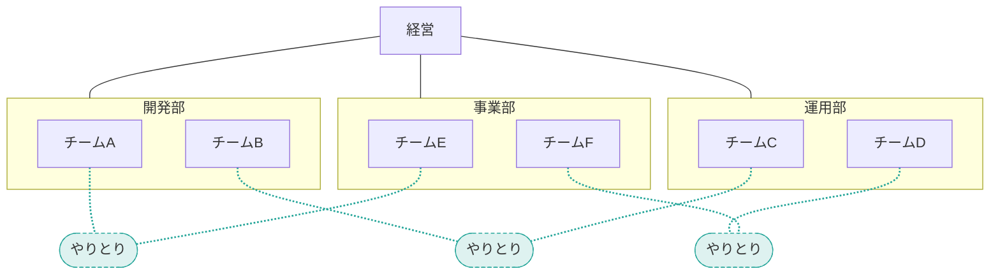
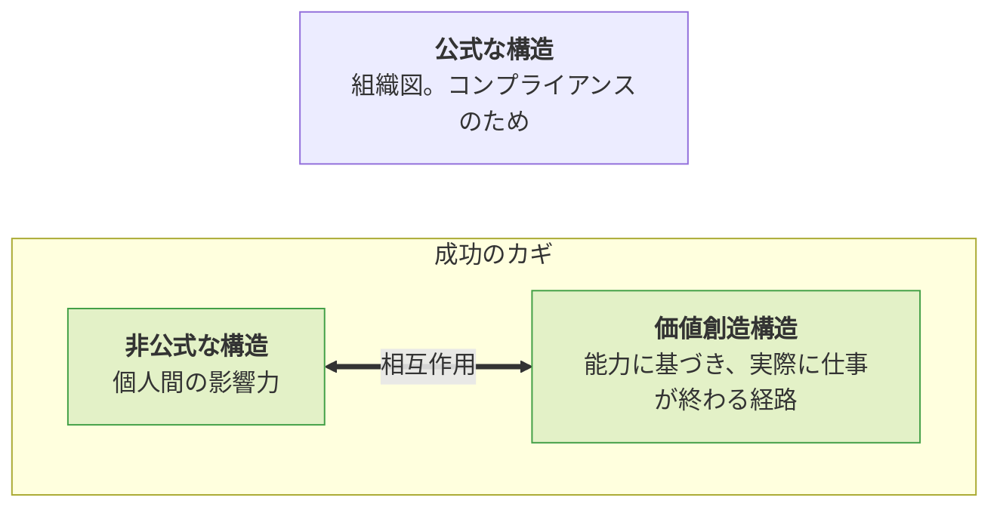
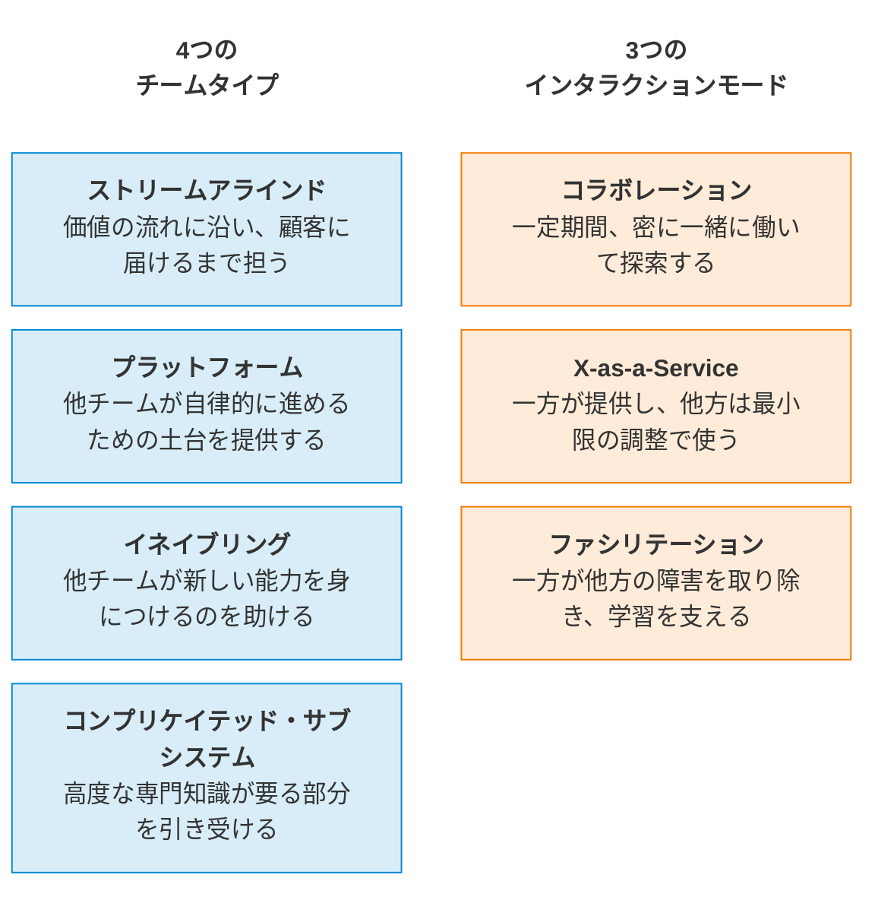
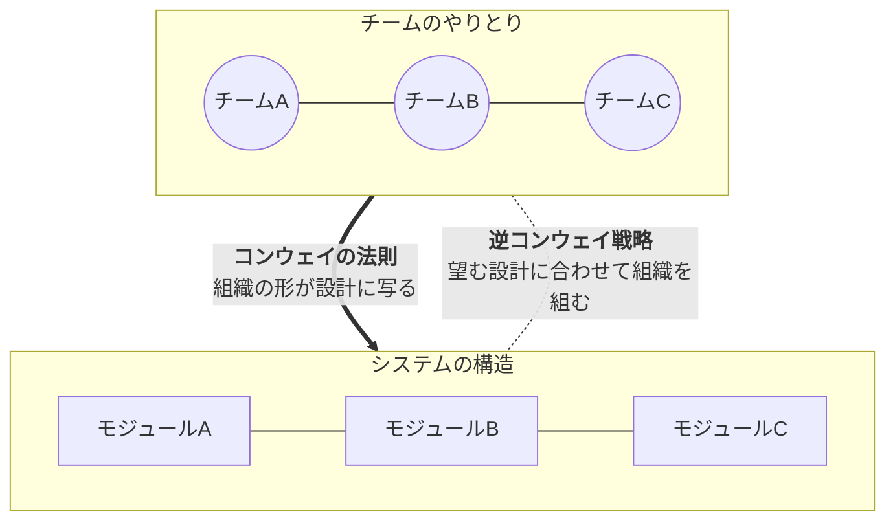
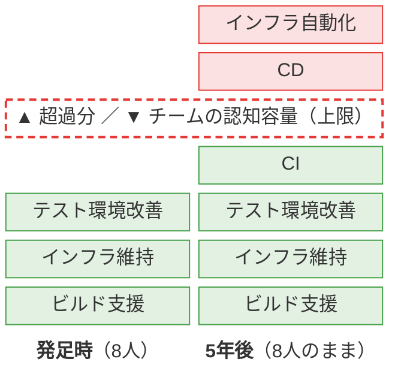
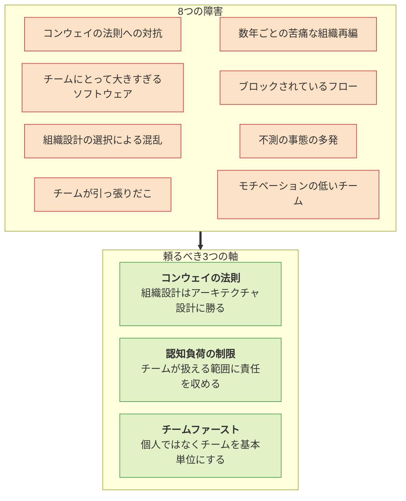

『チームトポロジー』読書メモ。章の流れに沿って、要点を Q&A 37問の形に整理した。答えは自分の言葉での要約であり、図は理解用に描き起こした概念図である。

## 1. 問題設定

> [!question]+ Q1. この章が出発点にしている問題意識は何か?
> ソフトウェアが生活と事業の中心になり、組織は「速く届けること」と「安全・安定に運用すること」を同時に求められている。にもかかわらず、人とチームの組み方が旧来のままで、それが現代的な開発・運用の足を引っ張っている。これが出発点である。

> [!question]+ Q2. 「速度か安定性か」という選択はなぜ成り立たなくなったのか?
> システムが相互接続され、不具合が移動・決済・医療などの実害に直結する一方、市場や規制の変化に素早く適応できなければ競争に負けるからだ。どちらかを犠牲にする最適化は選べなくなった。

> [!question]+ Q3. 著者はチームと技術をどう捉え直すべきだと言っているか?
> 「正しいプロセスとツールがあれば成功する」「チームは交換可能な個人の集まり」という見方を捨て、人と技術を一体の社会工学的(ソシオテクニカル)システムとして見るべきだとしている。同時に、チームには内発的な動機と、良い仕事ができる現実の機会が必要だとする。

## 2. 組織図の限界

**図A 組織図の線と実際のやりとり** 実線が組織図の線(レポートライン)、点線が実際のやりとり。仕事を終わらせるためのやりとりは、レポートラインをまたいで横方向に発生する。部署名とチーム名は説明用の例である。

> [!question]+ Q4. 組織図は何を表し、何を表していないのか?
> 表しているのは、部署やチームの上下関係とレポートラインである。表していないのは、仕事を終わらせるために実際に発生している横方向のやりとりだ。人は必要なら組織図の線を越えて誰とでも連絡を取るので、実際のコミュニケーションは図と大きくずれる。

> [!question]+ Q5. では組織図は無用なのか?
> 無用ではない。規制やコンプライアンスの遵守には役立つ。問題は、不確実性が高く協働が欠かせない仕事を分割する基本原理として、組織図を使ってしまうことにある。

> [!question]+ Q6. 組織図を額面どおりに受け取ると何が起きるか?
> 人間をソフトウェア部品のように設計し、コミュニケーションを決められた枠に押し込めようとしてしまう。その結果、仕事の割り当てや責任について現実に即した判断ができなくなる。アーキテクチャ文書が開発開始後すぐ陳腐化するのと同じで、組織図も常に現実とずれている。

> [!question]+ Q7. 「局所最適」の問題とは何か? 章中の例で説明せよ。
> 組織図の単位で意思決定をすると、その部分だけが良くなり、上流・下流への影響が無視される。例として、クラウドと Infrastructure as Code でインフラ準備が数週間から数分になっても、変更承認の会議が週1回のままなら、デリバリーの速度は結局1週間のままである。

**図B 局所最適とボトルネック** 全体の速度は最も遅い工程で決まる(速くても1週間)。一部の工程を改善しても、フロー全体の最大のボトルネックが残っていれば、顧客に届く速度は変わらない。

> [!question]+ Q8. それに対するシステム思考のアプローチは?
> 全体のフローを見て、その時点で最大のボトルネックを特定して取り除き、それを繰り返す。著者は、いずれチーム構造やコミュニケーションの硬直そのものがボトルネックになると指摘している。

## 3. 組織図に代わる見方

> [!question]+ Q9. プレイギングの「3つの組織構造」とは何か?
> 1. 公式な構造(組織図):コンプライアンスを円滑にする
> 2. 非公式な構造:個人間の影響力の領域
> 3. 価値創造構造:個人やチームの能力に基づき、実際に仕事がどう終わるか

**図C 3つの組織構造** 知的労働の成功を左右するのは、緑で示した2つ(非公式な構造と価値創造構造)の相互作用である。

> [!question]+ Q10. 3つのうち、成功のカギはどこにあるか?
> 非公式な構造と価値創造構造の相互作用、つまり人とチームのやりとりにある。チームトポロジーはこの認識を引き継いでいる。チームに権限を与えて基本単位として扱い、チーム間のやりとりの仕方を明示的に合意することで、期待が明確になり信頼が育つとする。

> [!question]+ Q11. マトリクスマネジメントはなぜ解決策にならなかったのか?
> 職能型よりはビジネス価値に目が向いているが、組織を静的なものとして捉えている点は同じだからだ。再編後に実際に起きるふるまいを考慮しておらず、事業や技術の変化が速まるほど時代遅れになる。

> [!question]+ Q12. 組織再編を繰り返すことの弊害は?
> 現場に恐怖や不安を生み、時間と労力の無駄と見なされがちである。さらに、次の技術・手法の変化のたびに再編が起き、できあがったコミュニケーションの形を壊し、うまく回り始めたチームを分割してしまう。

> [!question]+ Q13. 単一で静的な構造の代わりに、何が必要だとされているか?
> チームの成長やチーム間のやりとりを織り込み、現在の状況に適応できるモデルである。チームトポロジーは、技術組織に欠けていた動的な性質とセンシング(変化を感知する)能力をもたらすものと位置づけられている。

> [!question]+ Q14. スタンフォードの組織設計の5つの経験則は?
> 1. やむを得ない理由があるときに設計する
> 2. 判断のための選択肢を用意する
> 3. 適切な時期に設計する
> 4. 整合が取れていない箇所を探す
> 5. 将来を見据える
>
> 本書全体でこれらをどう扱うかを検討すると予告されている。

## 4. チームトポロジーの骨格

> [!question]+ Q15. チームトポロジーとは一言で言うと何か?
> ソフトウェアデリバリーのためのチーム構造を、技術・人・ビジネスの変化に合わせて進化させ続けるための実践的なガイドである。チームのサイズ、形、配置、責任、境界、やりとりを対象にしている。

> [!question]+ Q16. 4つの基本チームタイプと3つのインタラクションモードは?
> チームタイプは、ストリームアラインド、プラットフォーム、イネイブリング、コンプリケイテッド・サブシステムの4つである。インタラクションモードは、コラボレーション、X-as-a-Service、ファシリテーションの3つだ。この章では名前の提示のみで、詳細は後の章で扱われる。

**図D チームトポロジーの語彙** Chapter 1 で示されるのは名称だけである。各項目の一行説明は、後の章の内容に基づく補足として加えた。

> [!question]+ Q17. なぜ「進化」が強調されるのか?
> 適切な構造は成熟度で変わるからだ。技術やプロダクトの探索段階では、境界が重なる密な協働が成功に必要である。しかし確立した後も同じ構造を続けると、無駄な労力と誤解を生む。

> [!question]+ Q18. チームトポロジーの最終的なゴールは?
> 顧客のニーズに合うソフトウェアを、チームがより簡単に構築・実行し、オーナーシップを持てるようにすることである。また、戦略変更の必要を感知するための、特定の技術に依存しない仕組みを組織に与える。

> [!question]+ Q19. 「人間的なアプローチ」とは具体的にどういう意味か?
> チームをデリバリーの不可分な要素と捉え、チームの認知容量には尊重すべき上限があると認めることである。

## 5. コンウェイの法則

**図E コンウェイの法則と逆コンウェイ戦略** 太い矢印は放っておくと起きる現象、点線の矢印はそれを意図的に利用する設計手法である。AとCが直接やりとりしないなら、モジュールAとCの間にも直接の接点は生まれにくい。

> [!question]+ Q20. コンウェイの法則とは何か?
> 1968年にメルヴィン・コンウェイが論文で示した洞察である。システムを設計する組織は、自分たちのコミュニケーション構造を写し取った設計を生み出してしまう、というものだ。

> [!question]+ Q21. プレイギングの3構造との関係は?
> コンウェイの言う「組織の本当のコミュニケーションパス」は、プレイギングの価値創造構造に当たる。これと出来上がるアーキテクチャの間に強い相関がある。アラン・ケリーはこれを「同形力」と呼んでいる。

> [!question]+ Q22. この法則から、アーキテクチャ設計について何が言えるか?
> 理論上は理想的なアーキテクチャでも、組織の形と合わなければ、アーキテクチャか組織のどちらかを変えるしかない。したがって、実現可能なアーキテクチャを考えるには、チーム間のコミュニケーション構造の理解が必須である。「4グループでコンパイラを作ると4パスコンパイラになる」というレイモンドの冗談がこれを端的に表している。

> [!question]+ Q23. 逆コンウェイ戦略とは何か?
> 2015年頃、マイクロサービスの流行とともに Thoughtworks のジェームス・ルイスらが打ち出した考え方である。アーキテクチャ設計に従うようチームに求めるのではなく、実現したいアーキテクチャに合うようにチーム構造のほうを組む。

> [!question]+ Q24. この節の最重要の教訓は?
> アーキテクチャを独立した概念として設計でき、どんなチーム編成でも実装できる、という考えは根本的に誤りだということである。チーム構造が求めるアーキテクチャと一致しなければ、意図しない設計が生まれる。これは、チームの認知容量を超えるモノリスを分解すべき理由にもつながる(Chapter 6)。

## 6. 認知負荷とボトルネック

> [!question]+ Q25. 認知負荷とは何で、チームにどう当てはまるか?
> ある瞬間に頭にとどめておける情報量には限りがある、ということである。チームも同様で、メンバー全員の認知容量の合計を超えることはできない。

> [!question]+ Q26. なぜ責任の割り当て時に認知負荷が議論されないのか?
> 著者は2つの理由を推測している。容量や負荷を定量化するのが難しいこと、そして、チームは言われたことに黙って適応するものだと期待されていることだ。

> [!question]+ Q27. 認知負荷を無視すると何が起きるか?
> 責任範囲が広がりすぎ、仕事に熟達する余裕がなくなり、コンテキストスイッチに悩まされる。最終的に、チームがデリバリーのボトルネックになり、遅延、品質問題、モチベーション低下につながる。

**図F 責任の積み上がりと認知容量** OutSystems の事例を模式化した(量は説明用のイメージ)。人数と容量は変わらないのに責任だけが増え、上限を超えた分が切り替えの多発と意欲の低下として表れる。

> [!question]+ Q28. OutSystems の事例は何を示しているか?
> 8人の優秀なエンジニアリング・プロダクティビティチームが、5年の間にビルド支援、インフラ維持、テスト環境改善に加えて CI、CD、インフラ自動化まで担うようになった。その結果、優先順位づけが難しくなり、スプリント内で頻繁な切り替えが発生し、モチベーションが下がった。優秀なチームほど仕事が集まり「成功の犠牲」になる、という構図である。

> [!question]+ Q29. ダニエル・ピンクの3要素でこの事例をどう説明できるか?
> - 自律:複数チームからの要求と優先順位を絶えず調整することで失われた。
> - 熟達:何でも屋になることで深まらなくなった。
> - 目的:責任範囲が広すぎてぼやけた。
>
> 3つすべてが損なわれたので、モチベーション低下は当然だったと説明される。

> [!question]+ Q30. これは内部サービスチームだけの話か?
> そうではない。外部顧客向けのプロダクトチームでも同じである。担当するサービスやコンポーネントは時間とともに増え、既存サービスの修正・拡張も求められる。それなのに新規開発は、チームの時間をすべて使え、認知負荷がないかのように計画されがちだ。

> [!question]+ Q31. 対策として何が提唱されているか?
> チームを最優先し、認知負荷を制限することである。認知負荷を考えることは、チームサイズの決定、責任の割り当て、他チームとの境界設定に役立つ(詳細は Chapter 3)。

## 7. まとめ:構造、目的、インタラクションを再考する

> [!question]+ Q32. 速いフローを実現する上での障害には何が挙げられているか?
> 次の8つである(図G)。背景には、ソフトウェア開発を専門分化した製造業のように扱い、社会工学的な力学を考慮してこなかった歴史がある。

**図G 障害と、それに向き合う3つの軸** 上が速いフローを妨げる8つの障害、下が組織図の代わりに設計の拠り所とするもの。

> [!question]+ Q33. アジャイル、リーンIT、DevOps は何を実証したか?
> ビジネスのフローに沿った小規模で自律的なチームが、小さな反復で開発・リリースし、ユーザーのフィードバックで軌道修正することの価値である。加えて、テレメトリ(遠隔でのメトリクス収集)ツールの発展により、起きた問題への対処だけでなく、傾向に基づいて早期に判断できるようになった。

> [!question]+ Q34. それでも従来型組織が恩恵を受けきれないのはなぜか?
> 自動化やツール導入という手っ取り早い部分に注力し、文化や組織の変化が場当たり的になっているからだ。文化・組織の変化は見えにくく、効果測定も難しいが、長期的な成功を大きく左右する。

> [!question]+ Q35. 組織図の代わりに頼るべき3つの軸は?
> コンウェイの法則(組織設計はアーキテクチャ設計に勝る)、認知負荷の制限、チームファーストのアプローチである。これにより、明確な目的を持つチームを設計し、フローと戦略適応性を優先したチーム間のやりとりを促せる。

> [!question]+ Q36. チームトポロジーの目的を最も正確に言うと?
> どこで・いつ協働が必要か、どこで・いつ実行に集中してコミュニケーションの負担を減らすべきかを、組織が適応しながら動的に見つけられるようにする、アプローチと思考の道具を提供することである。

> [!question]+ Q37. NOTE のハタとウツボの話は何のたとえか?
> 一見無関係な2種の魚が、合図を送り合って明示的に協力し、岩の割れ目の小魚を捕らえる例である。性質の異なるチーム同士が、意図的で明確なやりとりを通じて、単独では得られない成果を出すことのたとえになっている。

## 仕上げの確認問題

1. 組織図、コンウェイの法則、認知負荷の3つは、互いにどうつながっているか?
2. 自分の組織で、組織図の線と実際のやりとりが最もずれているのはどこか?
3. 自分のチームの担当範囲は、この1〜2年でどう増えたか? 熟達できていない領域はあるか?
4. 最近ツールやクラウドで速くなったのに、全体のリードタイムが変わらなかった経験はあるか? そのボトルネックは何だったか?

---

出典:マシュー・スケルトン、マニュエル・パイス『チームトポロジー 価値あるソフトウェアをすばやく届ける適応型組織設計』Chapter 1。本ページは個人の学習用の要約であり、図は書籍の図版の複製ではなく、内容を理解するために描き起こした概念図である。
